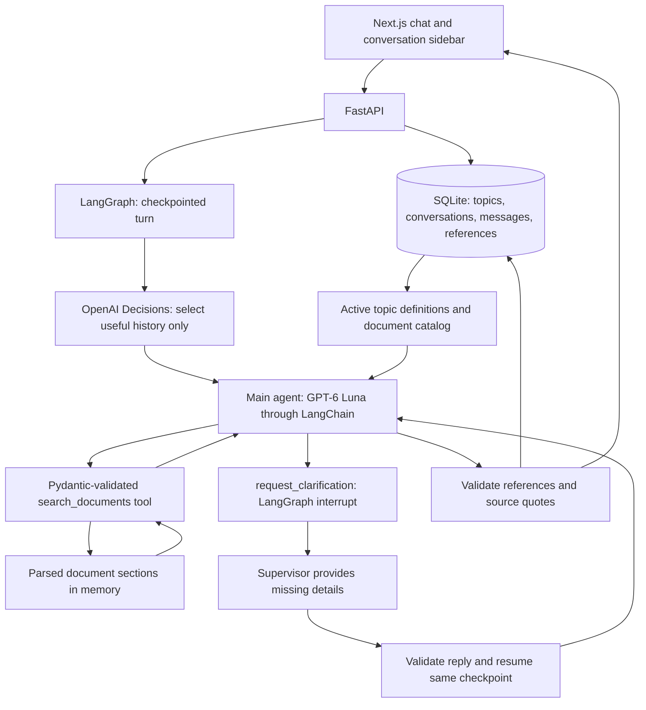

# Floor supervisor document chat — proposed plan

Author: Varad Ganjoo  
Date: 23 November 2026  
Status: Prototype implemented following user authorization. See README for verification and remaining live-service checks.

## Objective

Build a chat interface where a floor supervisor can ask questions about the available plant documents, inspect the evidence behind an answer, and return to previous conversations. Keep the full conversation in SQLite, but send only useful history and document excerpts to GPT-6 Luna.

The prototype uses local files loaded into application memory, LangChain for the answering model and typed tools, and LangGraph for execution and human clarification. It has no vector database, embeddings service, hosted file search, or secondary topic-routing agent.

## Confirmed scope and working assumptions

- Retain the existing FastAPI backend, Next.js TypeScript frontend, and root `.env` configuration.
- Use `gpt-6-luna` through LangChain's OpenAI Responses integration with `reasoning.effort="none"` for every answering-agent call. Use the OpenAI Decisions API only to select relevant conversation history.
- The main answering agent chooses relevant topics and documents from the database catalog. Neither the Decisions history selector nor another agent routes the question by topic.
- Define tool arguments and results with Pydantic, add bounded retries for transient search failures, and use LangGraph interrupts to request human clarification when necessary.
- Store topics and their definitions in SQLite. Runtime behavior must come from database records, with no topic enum, topic-specific branches, or fixed categories in the system prompt.
- Seed three initial topics and associate them with the existing DOCX files. Seed data is configuration, not a fixed runtime list.
- Allow new conversations, listing conversations by latest activity, reopening older conversations, and continuing them. “Ordered conversations” is interpreted as this chronological ordering; custom reordering is not included unless requested.
- Use a single local prototype workspace, with no authentication or per-supervisor permissions in the first version. This is not a shared public deployment design.
- The exact UI package called “asterisks” is unresolved. The plan defines the UI behavior independently; confirm its package name or URL before selecting dependencies. assistant-ui is a possible interpretation, not a confirmed choice.

The three supplied documents are marked **EXAMPLE ONLY — NOT RELEASED FOR OPERATION**. Preserve this status in the chat and reference details. Answers must not describe the examples as approved operating instructions.

## Architecture

Use an explicit LangGraph `StateGraph` with a history-selection node, one main model node, a document-search node, a clarification node, and final validation/persistence. LangChain supplies `ChatOpenAI` and tool definitions; use the official OpenAI Python SDK for Decisions. There is one answering agent, not a hierarchy of specialist agents. Continue using the existing `backend/.venv`; install and lock dependencies there when implementation begins.

Configure the model explicitly as `gpt-6-luna` with the Responses API. Verify the installed `langchain-openai` adapter supports the model's tool calls, structured output, and usage metadata before wiring the application. Do not silently switch models if access or adapter compatibility fails.

Explicitly send `reasoning: {"effort": "none"}` on every Responses request: action/tool selection, argument correction, resumed clarification, and final structured answering. Do not rely on provider defaults, request reasoning summaries, or increase the effort on retries. Inspect the serialized request in tests to ensure LangChain forwards this setting. Decisions uses its own documented request schema, which does not expose a reasoning-effort parameter; do not send an unsupported parameter there or claim that the endpoint offers the same control.

## 1. Data-driven topic catalog

Initial database records:

| Topic | Definition supplied to the model | Initial document |
| --- | --- | --- |
| Safety procedures | Workplace hazards, safe-work boundaries, PPE, hazardous-energy isolation, emergencies, and reporting unsafe conditions. | `Plant_Safety_Procedures.docx` |
| Maintenance manuals | Asset records, preventive maintenance, inspections, faults, repairs, and return-to-service checks. | `Plant_Maintenance_Manual.docx` |
| Quality control standards | Product requirements, measurement and inspection, acceptance criteria, traceability, nonconforming product, and release authority. | `Plant_Quality_Control_Standards.docx` |

Load active topic IDs, names, and definitions from SQLite for each request. A question may concern several topics, such as the safety checks before maintenance. Do not force every question into exactly one category.

Give this catalog directly to the main agent. It chooses topic IDs in its search-tool arguments and records the topics actually used in its final structured response. Display names are resolved from SQLite. The backend validates the IDs and document associations; it does not substitute a hard-coded classifier or let the history selector decide the source types. The agent may revise its selection after reading evidence.

Use an explicit import command that reads a manifest of topics, definitions, and local document paths. Adding a topic means adding a database record and importing its documents; it does not require editing Python or frontend code. Re-running the import updates matching records without duplicating them or resetting conversations. A topic-management UI is outside the initial scope.

## 2. Local documents and context-efficient search

At startup, parse the three DOCX files once and build an immutable in-memory section catalog. Use `python-docx` to preserve headings, paragraphs, tables, and their document order. Inspect the actual documents when defining section boundaries; do not flatten table cells into an unlabelled text blob.

Each section carries:

- Document ID and content hash/version.
- Topic ID, document title, revision, and example/release status.
- Heading path and section locator.
- Complete procedure steps or table rows with their headers.
- A stable section ID derived from the document version and location.

Search with a simple lexical ranking over headings and section text. Prefer exact asset IDs, part numbers, numerical terms, and heading matches. The model may supply alternate query wording through the tool. This is an explicit prototype limitation: lexical search may miss paraphrases with no shared terms.

The tool contract is `search_documents(query, topic_ids, document_ids, limit)`, where `document_ids` is optional and narrows the main agent's chosen topics to particular catalog documents. The backend validates IDs and associations, caps result counts, and enforces a cumulative excerpt budget. It returns source IDs, section metadata, and excerpts rather than complete manuals. Allow a small number of query reformulations when evidence is missing, with a fixed per-turn limit.

### Pydantic validation and search retries

Register tools with LangChain using Pydantic `args_schema` models. Validate tool outputs and the final answer as well as HTTP request bodies.

- `SearchDocumentsInput`: nonblank bounded query, a nonempty bounded list of topic IDs, optional document IDs, and a bounded integer result limit. Forbid unexpected fields. Topic IDs remain data-driven strings, not a fixed enum.
- Runtime validation checks that topics are active, documents belong to the selected topics, and files are available. The model never supplies arbitrary filesystem paths or SQL.
- `SearchDocumentsResult`: a typed success/no-results result with source IDs, versioned locators, excerpts, and truncation/continuation metadata. Do not turn an execution failure into an empty result.
- `ClarificationRequest` and `ClarificationReply`: bounded question/answer text and server-owned turn/interrupt identifiers; validate replies before resuming execution.
- `AnswerDraft`: draft content, selected topic IDs and supporting retrieved source IDs. `EvidenceReview` selects complete stored passages for the displayed answer; source quotes are copied by the server. Legacy `GroundedAnswer` drafts retain exact-quote checks for saved checkpoints.

Treat error categories differently:

| Condition | Planned behavior |
| --- | --- |
| Known transient search failure, such as a temporarily unavailable cache during an atomic reload | LangGraph `RetryPolicy`: at most three attempts total, short exponential backoff with jitter, and a search deadline. Retry only an explicit transient-error allowlist. |
| Invalid tool arguments or unknown topic/document IDs | Return a structured validation error to the main agent for one bounded correction. Do not repeatedly execute unchanged invalid arguments. |
| Valid search with no results | Let the main agent reformulate within the search budget or ask for clarification. This is not an infrastructure retry. |
| Missing/corrupt source, unsupported format, permission failure, or programming error | Surface the actual failure; do not retry it as though it were temporary or invent an answer. |
| Missing information in the user's question | Pause through the clarification flow below; do not retry a vague question. |

Local in-memory search normally needs no retry. The policy is available for genuinely transient failures and is tested with injected failures rather than manufactured on the normal path. Start with a maximum of three attempts per search execution (one initial attempt plus two retries), short exponential backoff with jitter, at most three distinct model-selected searches per turn, and one model correction of invalid tool arguments. These are tunable prototype limits. Keep retry-attempt counts separate from new searches, and never retry a whole multi-tool node if doing so would rerun successful calls. Apply bounded provider retries and an overall active-run deadline too; disable overlapping SDK/node retry layers so attempts do not multiply. Waiting for human input does not consume an active request timeout or keep an HTTP request open.

Never return a procedure fragment that drops an adjacent prerequisite or warning. Split oversized sections only at meaningful boundaries and preserve continuation metadata. If the tool cannot fit the context needed to answer safely, request a narrower question instead of silently omitting critical steps.

DOCX pagination depends on the renderer. References should use headings and section labels; do not fabricate page numbers. The existing PDFs can be considered later if stable page-level references become a requirement.

Replacing a document requires an explicit re-import/reload. Record a new content hash and rebuild the cache between requests; retain snapshots of previously cited evidence so old conversations still display the evidence originally used. Missing or unreadable documents must be visible as unavailable sources, not silently disappear.

## 3. SQLite persistence

Use an application SQLite database under `backend/data/`, excluded from version control. Use LangGraph's SQLite checkpointer in a separate file in the same directory so framework checkpoint tables do not share application transactions. Enable foreign keys and WAL mode where applicable. Use short transactions; never hold a database transaction open while waiting for OpenAI or human input.

| Table | Main fields and purpose |
| --- | --- |
| `topics` | `id`, unique `slug`, `name`, `description`, `active`, timestamps. Runtime topic catalog chosen by the main agent. |
| `documents` | `id`, `topic_id`, relative path, title, revision, content hash, availability/status. Local document registry. |
| `conversations` | `id`, title, created/updated timestamps. Sidebar order uses `updated_at DESC, id DESC`. |
| `messages` | `id`, `conversation_id`, sequence number, role, content, message kind, pending/awaiting-clarification/completed/failed/cancelled status, turn ID, request ID, timestamps, selected topic IDs, usage metadata. |
| `conversation_runs` | Turn ID, conversation ID, checkpoint thread ID, status, pending interrupt ID/payload, version, attempt/search/clarification counters, timestamps. Durable run status and resume idempotency. |
| `message_references` | Assistant message ID, reference number, document/version ID, section ID and heading, exact supporting excerpt, citation snapshot metadata. |

Derive the first conversation title from the first user message rather than paying for a title-generation call. Preserve message ordering with sequence numbers and enforce request-ID uniqueness to prevent duplicate sends on retry. Admit only one active turn per conversation; separate conversations may run concurrently.

Save the user message before inference, then save the complete assistant answer and its references atomically after validation. Persist clarification questions and user replies in the visible transcript too, using stable IDs so graph replay does not duplicate them. A failure retains the user's question and exposes a retryable error. Reopening history reads stored content and does not call the LLM again.

Use a stable LangGraph `thread_id` derived by the server from the conversation ID and a distinct turn/run ID for each question. Pending clarification checkpoints survive a restart and remain resumable. The checkpoint is authoritative for the graph's current interrupt; application run status and transcript are projections reconciled from it on restart. Interrupted active work without a human-wait checkpoint is recovered or marked failed explicitly. Cross-file writes are not assumed atomic: use idempotent upserts and reconcile crash windows, including a checkpoint saved just before a transcript/status update.

The complete SQLite transcript and the graph's working messages have different jobs. Replace working context with the selected history at the start of each new turn instead of accumulating all messages through an append reducer. Preserve only the bounded current run, tool-call/result pairs, counters, source snapshots and pending clarification state needed to resume. Rehydrating a checkpoint must not automatically send its entire history to the LLM.

## 4. Decisions-based history selection

SQLite remains the complete record. The model's working context is rebuilt for every turn; do not automatically resend the entire conversation or use an ever-growing `previous_response_id` chain.

Proposed selection process:

1. Read the latest user question and a small recent window of complete user/assistant turns.
2. When history is longer, collect a bounded set of older candidate turns using a local lexical search over that conversation. Never fetch candidates from another conversation.
3. Send a bounded Decisions request with the question and candidate turns. Generate one `predicate` question per candidate turn to assess usefulness for understanding and answering the current question. Do not ask Decisions to choose topics or documents.
4. Include only turns selected as relevant by the Decisions API, in chronological order until the history budget is full. The latest turn is a candidate, not an automatic inclusion. Keep user/assistant turns together; previous tool text is not independent evidence.
5. Validate decision names and probabilities against the supplied history candidates. Treat refusal or malformed output as an explicit decision failure; do not substitute an unrelated model or claim that full-history fallback is cost-efficient.

Skip the Decisions call when there is no history to filter. Its role remains a history-selection utility, not a second answering agent.

Initial limits are tuning values, not established performance claims: recent two completed turns, at most 20 older candidates, approximately 3,000 tokens of selected history, up to 6,000 tokens of new evidence per search and 18,000 across three searches, and a bounded answer length. Already retrieved sections are excluded from later searches. Count with a verified model-compatible tokenizer or a conservative UTF-8 byte bound and reserve space for instructions, tool schemas, and output. Adjust after measuring the actual documents and test questions.

A single Decisions request can assess several candidate turns using shared input. It cannot generate a free-form rewritten question; that belongs in the main agent if needed. The main agent receives selected history plus the dynamic topic/document catalog and makes source-selection and clarification decisions itself. Relevance thresholds must be calibrated using examples, not presented as correctness guarantees.

For a resumed clarification, keep the pending question, its linked human reply, and the bounded active tool context together. Re-evaluate older-history relevance with the added clarification when it changes the meaning of the original query; do not discard the pending turn or start an unrelated conversation.

Do not add a summarization model in the first version. Save per-turn token usage, selected-history count, search count, and elapsed time to measure whether selection reduces total cost and latency, including the Decisions call itself. Long conversations with implicit references to very old turns remain a recall risk and must be tested explicitly.

## 5. Answering agent and references

The agent receives the selected history, dynamic topic definitions, and a read-only document-search tool. Require document-grounded answers for plant questions. It should ask for missing asset/task details when they change the answer, acknowledge conflicting or insufficient evidence, and preserve numerical units and restrictions.

The main model node chooses its next action: call `search_documents` with the relevant catalog topic/document IDs, call `request_clarification` with one targeted question, or provide a grounded final answer. LangGraph's conditional edges execute the selected action. A topic overlap by itself is not a reason to interrupt: the agent can search several topics. No separate routing or ambiguity-classifier agent is introduced.

Use GPT-6 Luna through Responses with reasoning effort explicitly set to `none`. Evaluate answer quality under that setting; do not enable reasoning as a fallback. Cap tool iterations and output length. Keep OpenAI credentials in backend settings; frontend requests never supply model credentials or arbitrary document paths. Document contents and prior messages are evidence, not instructions that may replace the agent's system rules.

### Human-in-the-loop clarification

Human verification here means that the supervisor supplies or confirms missing context before the agent continues. It does not require approval for every read-only search or every final answer.

Example: “What should I check before restarting it?” without an identifiable asset or task leads to “Which machine are you restarting, and what maintenance was performed?” A reply such as “CV 01 after a belt replacement” resumes the same pending turn and lets the main agent select maintenance, safety, and any relevant quality material.

1. The main agent emits `request_clarification` with a targeted question and a short description of the missing information. Validate the payload with Pydantic.
2. A dedicated clarification node calls LangGraph `interrupt()` using the already-generated payload. Keep LLM calls and non-idempotent writes out of the work before this interrupt; the node restarts on resume. Never catch and suppress LangGraph's interrupt control flow in a generic tool-error handler.
3. The SQLite checkpointer saves the run. FastAPI returns `status=awaiting_clarification` with server-owned conversation/turn/interrupt IDs and the question. End the HTTP request; do not poll the LLM or hold a connection open while the user thinks.
4. The UI displays the question as a clarification message, marks the conversation as waiting for a reply, and uses the composer to collect that reply. Reloading or switching away and back restores the pending question from persisted state.
5. The backend validates a nonempty reply, request ID, current run version, and matching interrupt/conversation before invoking `Command(resume=...)` with the same `thread_id`. A stale, cross-conversation, or duplicate resume cannot advance the wrong run.
6. Return the reply to the main agent as clarification context, retain the original question, refresh history selection if needed, and continue through search and grounded answering. Persist the human reply exactly once.
7. Allow a bounded number of clarification rounds, initially two per turn. Persist counters across pauses so resumes do not reset tool/retry budgets. If the query remains unanswerable, explain what is missing or unsupported. Allow cancellation of the waiting turn without deleting its transcript, then allow a new question.

Deterministic recovery requirements: checkpoint/transcript reconciliation after a crash, no repeated paid model call merely to re-show a stored clarification prompt, no duplicate question/reply on replay, no retry of a human interrupt, and no final answer published before the necessary clarification arrives.

### Citation API distinction

OpenAI's documented built-in `file_citation` annotations are produced by its hosted file-search tool, which uses vector stores. That does not establish native file citations for a custom in-memory function tool. Do not invent a separate Citations endpoint or present application references as provider-issued annotations.

The main agent submits a structured draft and supporting retrieved source IDs. A bounded, structured Luna call checks the question and draft against complete retrieved passages and selects passage IDs. Complete table rows and numbered procedures appear directly in the answer. The server copies citation text from these stored passages, validates source membership and exact substring provenance, and creates reference bubbles containing title, revision, heading and quote. Unknown passage IDs are rejected. Legacy source/quote drafts remain readable for durable checkpoints and retain exact-quote validation. Passage selection is not proof that every summary claim is entailed; evaluate semantic support and completeness independently and abstain when information is insufficient.

Store the validated references alongside the answer so they survive reloads and document updates. A source preview displays the stored excerpt and its version; it must not silently substitute the latest document text.

If provider-native citations are a strict requirement, this remains a design decision to resolve before implementation. The proposed local references satisfy the visible reference-bubble behavior without a vector store.

## 6. Chat UI and API

Desktop layout: a conversation sidebar, active chat, and a source preview opened from a numbered reference bubble. Mobile layout: the same chat with a collapsible conversation list and touch-accessible source previews.

UI behaviors:

- New conversation, newest-first history, switching between old conversations, and continuing a selected chat.
- Multi-line composer; Enter sends and Shift+Enter inserts a newline, with IME composition protected.
- Loading and error states, retry without duplicate user messages, and a disabled send action during the active turn.
- A distinct awaiting-clarification state with the original question, targeted follow-up, reply/cancel controls, and restart-safe continuation. The composer is enabled for the clarification reply while a paused run is waiting; ordinary new-question sends cannot accidentally bypass that pending run.
- Reference bubbles reachable by keyboard and touch, with visible focus, document/section details, and exact quoted evidence.
- Preserve scroll position when reading older messages; only follow new messages when already near the bottom, with a new-message/scroll-to-bottom affordance otherwise.
- Accessible labels and status announcements; do not announce every generated character or move focus unexpectedly.
- A persistent indication that the source documents are demonstration material, reflecting their actual status.

Start with ordinary REST responses and progress/loading states. Publish the final answer only after references pass validation. Token-by-token streaming is deferred; it would require a policy for displaying unvalidated claims and more client/server state. Do not add WebSockets or a background-job service for this prototype.

Proposed API surface:

| Method and path | Purpose |
| --- | --- |
| `GET /api/topics` | Read active topics from SQLite. |
| `POST /api/conversations` | Create an empty conversation. |
| `GET /api/conversations` | Paginated newest-first conversations. |
| `GET /api/conversations/{id}/messages` | Paginated ordered history with references and statuses. |
| `POST /api/conversations/{id}/messages` | Persist a question and return a completed answer/references, awaiting-clarification payload, or explicit failure. Accept an idempotency request ID. |
| `GET /api/conversations/{id}/run` | Restore current run status and pending clarification using server-owned identifiers. |
| `POST /api/conversations/{id}/resume` | Validate and persist a clarification reply and resume the matching checkpoint. Accept turn/interrupt IDs, current version and an idempotency request ID. |
| `POST /api/conversations/{id}/runs/{turn_id}/cancel` | Cancel the current waiting turn idempotently while preserving transcript/history. |
| `GET /api/messages/{message_id}/references/{number}` | Inspect the stored source snapshot. |

Keep the existing `/api/health`. Use consistent validation/error responses for missing conversations, oversized questions, active turns, missing documents, decision failures, provider timeouts, rate limits, unavailable model access, malformed tool input and stale/invalid clarification resumes. Return ordinary validation errors for blank clarification replies without consuming the pending interrupt.

## 7. Application and agent observability

The detailed [observability plan](observability-plan.md) defines session/run IDs, logs, traces, metrics, content handling, run inspection, and acceptance checks. It is part of this design, not an optional follow-up task.

- Treat each conversation as a tracked agent session. Keep its ID across reloads and clarification pauses. Each user question has a stable turn ID; every initial/resumed execution and every HTTP request has a separate identifier.
- Store exact questions, clarification messages, final answers, references, statuses, and structured action events in SQLite. Keep full content in the existing message tables and join it from the inspector rather than copying it into every log line.
- Use LangSmith for LangChain/LangGraph model, tool and node traces when configured. Instrument the direct Decisions SDK call explicitly; do not assume LangChain automatically traces it. Propagate conversation/turn metadata to child runs too.
- Add structured JSON application logs for FastAPI, Next.js proxy requests, database work, document loading, and frontend failures. Correlate them with the local run ledger and LangSmith trace IDs.
- Measure browser-visible response time, server request duration, active agent duration, provider/tool/validation/database durations, retry backoff, and human waiting time as distinct quantities. Use monotonic clocks for in-process durations and UTC timestamps for cross-process/restart correlation.
- Record visible agent actions: topic/document choices, search queries/results, selected history IDs and Decisions probabilities, clarification requests, validation results and errors. This is an action record; do not request private chain-of-thought.
- Record configured/returned model IDs, prompt/app version, `reasoning_effort=none`, provider request/response IDs, actual token usage, and optional price-versioned cost estimates. Missing provider fields remain unknown rather than being recorded as zero.
- Provide a small read-only local run inspector showing sessions, questions/answers, action timelines, timing breakdowns, errors and trace links, plus p50/p95 latency and failure summaries with sample counts. Detailed endpoint and measurement definitions are in the linked plan.
- Local logs and the run ledger work without a LangSmith key. External trace export is configurable and excludes message/document content by default; content export requires an explicit setting. Secrets must be removed from root and child spans, errors and metadata. Trace-export failure must not break an otherwise successful chat turn.

## 8. Implementation sequence

1. **Resolve the UI library and citation contract.** Confirm “asterisks,” settle application-validated versus provider-native references, and finalize this plan before application code changes.
2. **Persistence and import.** Add application SQLite tables, the LangGraph SQLite checkpointer, topic/document manifest import, document parsing/cache, and restart-safe conversation/run storage. Preserve the existing health endpoint.
   Add the observability identity/context helpers, run ledger, JSON logs and request timing at this stage so later nodes are instrumented from their first implementation.
3. **Retrieval and context selection.** Add Pydantic tool contracts, runtime catalog validation, the in-memory search tool with bounded transient retries, Decisions-based history selection only, and measurable context limits.
4. **Agent graph and clarification.** Add the LangChain OpenAI integration and LangGraph state/nodes/edges. The main agent selects topics/documents and chooses searches or clarification; implement durable interrupt/resume/cancel and idempotent replay.
5. **Answer validation and chat interface.** Add structured grounded answers and source/quote validation, then integrate the confirmed UI package, conversation sidebar, clarification UI, history loading, reference bubbles, and source previews through the existing Next.js API proxy. Add browser timings and the local run inspector. Instrument Decisions, model calls, tools, retries, pause/resume, validation and persistence, then verify trace export if configured.
6. **Verification and handoff.** Run backend tests, frontend lint/type check/build, a small controlled live OpenAI smoke test, and browser checks at desktop and mobile widths. Verify non-thinking request settings, session/trace correlation and observability failure behavior. Record actual token/latency results without assuming savings.

## 9. Acceptance checks

- The main agent selects each topic using its database definition; a mixed question can select several topics. Decisions requests contain only history-selection questions, not source-routing questions.
- Add a fourth topic and a document through data/import only. The agent and UI recognize it without code changes.
- Search returns the right procedure and preserves safety prerequisites, table headers, asset IDs, tolerances, and units.
- A follow-up such as “What about before restarting it?” retains relevant context; unrelated old turns are omitted.
- Very old but relevant context can be recovered when candidate retrieval finds it; tests expose cases lexical retrieval misses.
- Conversations, message order, errors, and reference snapshots survive a backend restart.
- Duplicate retries do not create duplicate turns; overlapping sends in one conversation are handled explicitly.
- Pydantic rejects empty queries, excessive limits, unexpected fields and malformed IDs; runtime checks reject inactive topics and mismatched documents. A bounded argument correction is distinct from a transient retry.
- An injected transient search failure succeeds within the retry cap; a permanent failure is not retried; no results prompts reformulation/clarification rather than repeated identical searches. Provider and graph retry layers do not multiply attempts.
- A vague query produces a targeted clarification interrupt; no answer is fabricated while waiting. A sufficiently clear broad or mixed-topic query does not trigger unnecessary clarification.
- A valid reply resumes the same run; the agent reselects topics using clarified context. Blank, stale, duplicate and cross-conversation replies do not consume or corrupt the interrupt.
- Pause, restart the backend, reopen the conversation, and resume successfully. Crash-window replay does not duplicate questions, replies, answer writes or source references.
- Persisted clarification/search/retry counters remain bounded across resumes; cancelling a waiting turn preserves history and permits a new turn.
- Unsupported or insufficient evidence produces clarification or abstention, not an invented instruction.
- Unknown source IDs and fabricated quotes are rejected; edited source files do not rewrite old evidence.
- Instructions embedded in documents do not override agent behavior or expose credentials.
- Provider outage, rate limit, missing key, missing file, and model-access errors preserve the user's question.
- New/old conversation navigation and reference bubbles work with keyboard and touch at mobile and desktop widths.
- Token and latency measurements include Decisions, tool-loop requests, input history, evidence, and output. Compare against a controlled full-history/full-document baseline using the same questions.
- Every answering-agent Responses request serializes `reasoning.effort="none"`, including retries, schema corrections and resumed turns. No fallback enables reasoning. Decisions requests use their own supported schema without invented reasoning parameters.
- Run the acceptance checks in the observability plan: exact question/answer visibility, isolated session IDs, trace coverage, separate human-wait and active latency, usage accounting, redaction and export-outage handling.

## 10. Deferred features and limits

No vector database, embeddings, hosted document search, secondary routing agent, external memory service, authentication, role permissions, OCR, arbitrary uploads, topic-management UI, conversation deletion/editing/branching, or custom sidebar ordering in the first version. LangChain and LangGraph are explicitly in scope for the single answering agent and human clarification. Model access and the installed adapter compatibility have not been tested with the project's key, and no paid requests are needed to prepare this plan.

The prototype keeps files in memory per worker and rebuilds its catalog at startup. Use one backend worker initially. Lexical recall and the demonstration status of the source material are the main answer-quality limitations.

## Verified references

- [OpenAI GPT-6 Luna: model ID, Responses, function calling and structured outputs](https://developers.openai.com/api/docs/models/gpt-6-luna)
- [OpenAI Decisions: predicates and conversation input for history selection](https://developers.openai.com/api/docs/guides/decisions)
- [OpenAI Decisions request schema](https://developers.openai.com/api/reference/resources/decisions/methods/create)
- [LangSmith conversation/thread correlation](https://docs.langchain.com/langsmith/threads)
- [LangChain observability and trace metadata](https://docs.langchain.com/oss/python/langchain/observability)
- [LangSmith input/output masking](https://docs.langchain.com/langsmith/mask-inputs-outputs)
- [LangChain tools: Pydantic argument schemas](https://docs.langchain.com/oss/python/langchain/tools)
- [LangGraph interrupts: pause/resume, stable thread IDs and replay behavior](https://docs.langchain.com/oss/python/langgraph/interrupts)
- [LangGraph retry policies](https://docs.langchain.com/oss/python/langgraph/graph-api-nodes#add-retry-policies)
- [OpenAI file search: vector-store configuration and file-citation annotations](https://developers.openai.com/api/docs/guides/tools-file-search)
- [assistant-ui source components — possible UI interpretation, pending confirmation](https://www.assistant-ui.com/elements/sources)
- [Modern Web Guidance](https://github.com/GoogleChrome/modern-web-guidance), consulted for accessible chat input and IME-safe submission.

## EGM review state

This is an anchored working draft, not a completed Goldfish review or an approved implementation specification. First resolve the UI-package name and any changes to the scope. The EGM brainstorming workflow requires explicit readiness confirmation before dispatching fresh-context Goldfish reviewers; no reviewers have been launched. Their findings should be incorporated into this plan before implementation.
