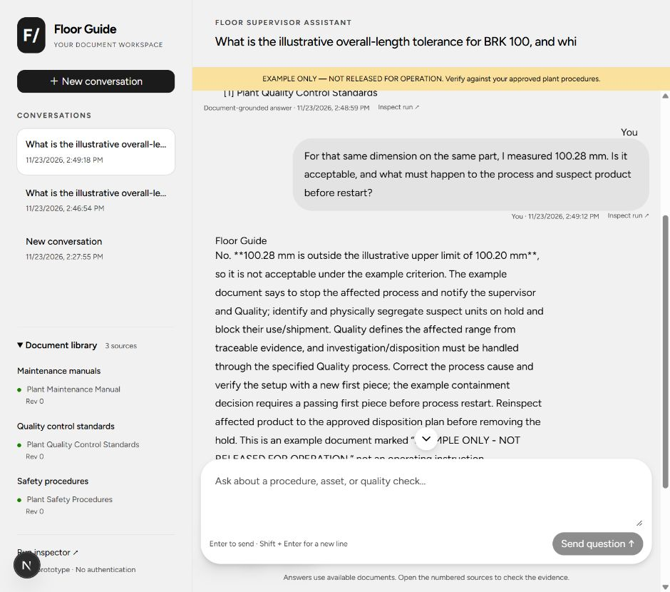

# Context-dependent golden test

Date: 23 November 2026. Result: **PASS for this two-turn scenario**.

Both questions were typed and submitted through the Next.js chat at
http://127.0.0.1:3000, backed by the real FastAPI/LangGraph agent and paid OpenAI
requests. Model: `gpt-6-luna`; reasoning effort: `none`. No golden answers or
grading criteria were provided to the agent. Only the three example DOCX sources
were searchable. This is a development check, not a full-dataset accuracy score.

## Questions

1. Exact golden case **PLANT-RAG-026**: “What is the illustrative overall-length
   tolerance for BRK 100, and which measurement method is listed?”
2. Contextual adaptation of **PLANT-RAG-029**: “For that same dimension on the
   same part, I measured 100.28 mm. Is it acceptable, and what must happen to the
   process and suspect product before restart?”

The follow-up deliberately omits the part number, dimension name, tolerance,
and inspection method. It must resolve “that same dimension” from the prior
turn, then retrieve the containment and restart requirements.

## Checks against the golden required facts

| Check | Observed answer | Result |
| --- | --- | --- |
| Case 026: tolerance | 100.00 mm ± 0.20 mm | Pass |
| Case 026: method | Approved calibrated caliper | Pass |
| Case 029: compare result with upper limit | Rejected 100.28 mm against 100.20 mm | Pass |
| Case 029: immediate action | Stop affected process and hold suspect product | Pass |
| Case 029: authority and restart | Quality defines affected range and disposition; passing first piece before restart | Pass |
| Citations | Opened reference 2 and verified its exact containment-decision quote | Pass |
| History selection | Decisions API selected the previous completed turn with probability 1.0 | Pass |
| New evidence | Follow-up retrieved section 4, absent from the first turn's retrieved sections 2 and 3 | Pass |

Manual semantic review found all required facts present and no contradiction
with the case's source evidence. The answer preserved the example-only warning.

## Recorded execution

Conversation: `45a365aa-4854-41f3-bfcb-a8fff6783868`.

| Turn | Run | Agent active time | Input tokens | Output tokens |
| --- | --- | ---: | ---: | ---: |
| Initial | `bc8d26f9-d192-4014-b7b5-915f9e881fff` | 4,064 ms | 3,278 | 179 |
| Follow-up | `63c3a6cf-3e57-41cc-994b-d6d91f327895` | 6,293 ms | 4,165 | 521 |

Token totals include recorded history-selection usage. Active time excludes
time between the two user submissions. The test transcript and evidence
snapshots are saved in the application's SQLite database.

The follow-up cited `Plant Quality Control Standards`, revision 0, section
`4 Nonconforming product and shipment release`, source
`plant-quality:777a5c6071b3:4`. Its containment example explicitly gives the
100.28 mm versus 100.20 mm comparison and the hold/Quality/first-piece steps.

## Regression validation

65 backend tests pass, including exact-quote validation for both grounded and
insufficient-evidence answers, Decisions-based history inclusion/exclusion,
and nonduplicating follow-up retrieval. Backend Ruff checks pass. Frontend
lint, type checking, seven state tests, and production build pass. Mobile
testing was excluded as requested.
