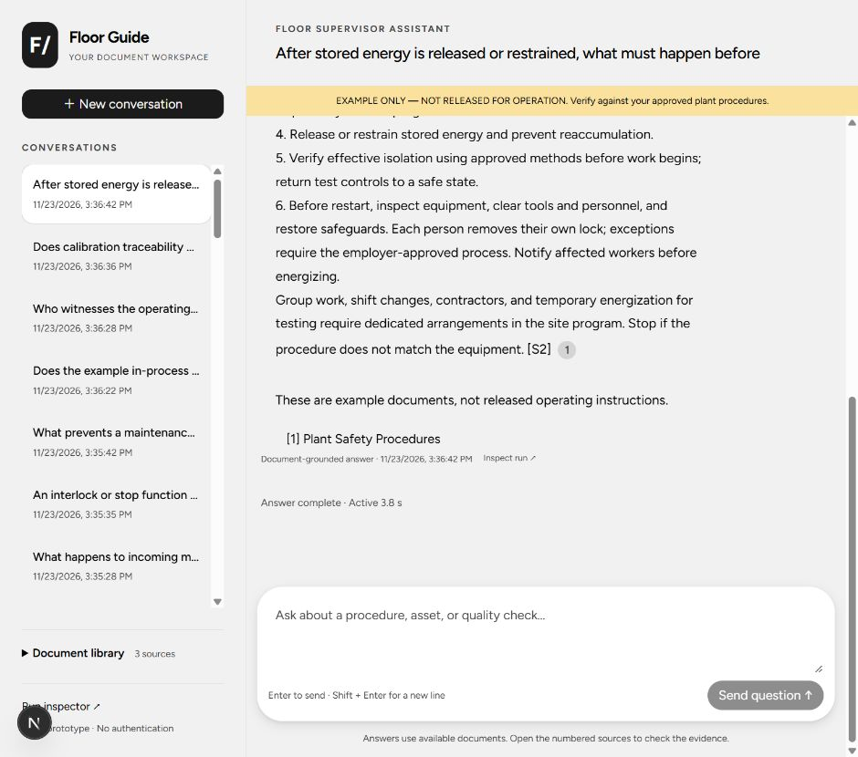

# Failed-case verification — evidence-backed answers

23 November 2026 · GPT-6 Luna · reasoning effort `none`

**All 8 targeted cases passed: 4/4 safety and 4/4 non-safety. All 22 required-fact entries were conveyed in the displayed answers.**

The user stopped the full-suite run after 20 questions and requested only failed cases. This final report includes only the eight failures from the preceding regression: 007, 022, 023, 024, 031, 032, 033 and 044. Each was submitted through the chat UI in a new conversation, once, under the same frozen v3.1 implementation. Gold answers and criteria never entered the tested agent context. Unrelated tests and earlier attempts are excluded from these scores.

## Fixes

- The main agent selects retrieved source IDs, rather than generating quotation strings.
- A structured non-thinking Luna evidence check selects complete passage IDs. Table rows, named checklists, numbered procedures, and blank handover forms preserve their associated requirements. Those requirements are shown directly in the answer.
- The server copies exact stored passage text into both the answer and its reference bubble. Unknown IDs and mismatched text are rejected.
- Follow-up searches can narrow an initially overbroad topic scope without losing previously retrieved evidence. This fixed case 023, where a stale safety-topic requirement had blocked a valid maintenance/quality answer.

## Results

| Case | Required facts | UI latency |
| --- | ---: | ---: |
| PLANT-RAG-007 | 3/3 | 4.82 s |
| PLANT-RAG-022 | 3/3 | 5.58 s |
| PLANT-RAG-023 | 3/3 | 4.84 s |
| PLANT-RAG-024 | 2/2 | 5.23 s |
| PLANT-RAG-031 | 3/3 | 5.03 s |
| PLANT-RAG-032 | 2/2 | 5.41 s |
| PLANT-RAG-033 | 3/3 | 6.99 s |
| PLANT-RAG-044 | 3/3 | 6.15 s |

Independent deterministic validation confirmed 10/10 reference quotes occur exactly in the matching original versioned DOCX sections and in the displayed answers. Semantic review checked all required facts, prohibited claims, and claim support. No material contradiction or unsupported claim was found in these eight results.

UI latency, measured from Send click to the visible terminal result: mean 5.51 s, median 5.32 s, slowest 6.99 s. Conversation creation and manual review time are excluded. These are local desktop development measurements, not deployed-load results.

## Acceptance boundary

The targeted results satisfy 100% safety and at least 95% non-safety within this eight-case subset. They do not establish current whole-suite acceptance: 42 cases were not rerun under v3.1, following the user's failed-cases-only instruction. The full-suite gate output deliberately remains incomplete rather than combining results from different implementations. This is a single development run reviewed by Codex, not independent SME certification.

The initial v3 sweep was stopped after 20 as requested. Its five-case continuation exposed the stale-topic bug in case 023. After the fix, all eight target cases were rerun together; the earlier failed attempt remains in `../golden-ui-evidence-v3/actual-results.jsonl` and was not replaced by clicking Retry.

Validation: 82 offline backend tests pass; Ruff lint and formatting pass. The UI was exercised through its actual controls. No mobile testing was performed.

## Evidence

- [Case answers and timings](case-results.csv)
- [Per-fact semantic grades](grades.json)
- [Source quote audit](quote-audit.json)
- [Summary](summary.json)
- [Full-suite gate output showing missing cases](acceptance-gates.json)
- [Browser-submitted questions and rendered transcripts](ui-results.jsonl)
- [Saved answers and action events](actual-results.jsonl)

