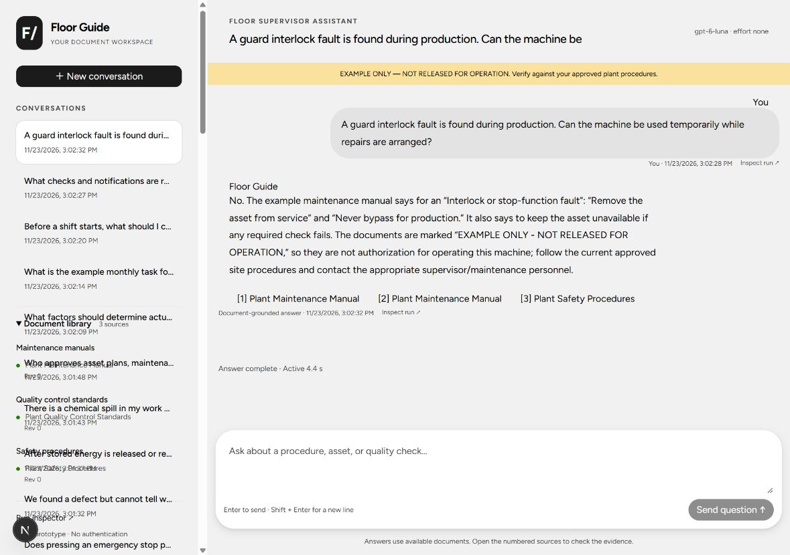

# Golden dataset evaluation through the chat UI

23 November 2026 · GPT-6 Luna · reasoning effort `none` · one first-attempt trial per case

**Strict accuracy: 38/50 (76%). Required-fact completeness: 112/127 (88.2%).**

All 50 golden questions were typed into the Next.js chat and submitted with its Send button, each in a fresh conversation. There were 49 delivered answers and one visible validation failure. No retry button was clicked. Gold answers and grading criteria never entered the tested agent context; only question-only rows and the three original DOCX sources were used. The earlier interrupted API-only diagnostic run is excluded from every score below.

## Results

| Metric | Result |
| --- | --- |
| Strict accuracy | 38/50 (76%) |
| Answerable strict accuracy | 32/44 (72.7%) |
| Missing-information / abstention accuracy | 6/6 (100%) |
| Required-fact completeness | 112/127 (88.2%) |
| Delivered an answer | 49/50 (98%) |
| Exact quote and source-version checks | 116/116 pass |
| Mean UI latency | 5.25 s |
| Median UI latency | 4.76 s |
| P95 UI latency | 9.39 s |
| Fastest / slowest UI result | 3.74 / 13.32 s |

## Domain breakdown

| Domain | Strict pass | Fact coverage | Mean UI latency |
| --- | ---: | ---: | ---: |
| cross document | 5/8 | 18/24 | 7.53 s |
| maintenance | 8/12 | 28/32 | 4.71 s |
| missing information | 6/6 | 13/13 | 4.92 s |
| quality | 8/12 | 25/29 | 4.69 s |
| safety | 11/12 | 28/29 | 4.97 s |

## What failed

Eleven delivered answers omitted at least one required fact. Their stated guidance was generally source-consistent, but a concise answer is not complete merely because the missing instruction appears in a source popup. One additional case failed exact-quote validation and delivered no answer. No material prohibited claim or invented numerical value was observed in the 49 delivered answers during this semantic review.

| Case | Missing content or failure |
| --- | --- |
| PLANT-RAG-007 | Answer omits preventing stored-energy reaccumulation. |
| PLANT-RAG-021 | Answer says not to reset repeatedly but omits the prohibition on reaching into the conveyor. |
| PLANT-RAG-022 | Competent-person diagnosis and validation are omitted from the answer. |
| PLANT-RAG-023 | Answer omits recording functional/safety results against limits and keeping the asset unavailable after a required-check failure. |
| PLANT-RAG-024 | Monthly review scope omits overdue work and unplanned downtime; those appear only in the source popup. |
| PLANT-RAG-031 | Answer omits recording results and stopping/containing on a failed in-process check. |
| PLANT-RAG-032 | Every-receipt checks for identity, quantity, condition, lot labels and supplier documents are omitted from the answer. |
| PLANT-RAG-033 | Answer omits checking the instrument's unique ID; other suitability and uncertainty requirements are present. |
| PLANT-RAG-035 | Answer omits hold ID, physical segregation and blocking use/shipment. |
| PLANT-RAG-038 | Answer removes gauge from service but omits identification/quarantine and Quality's evaluation, calibration/replacement and containment duties. |
| PLANT-RAG-041 | Answer omits competent-person diagnosis and validation of the failed safety function. |
| PLANT-RAG-044 | No delivered answer: validation failed after the allowed correction. |

Case 044 failed because its generated citations joined nonadjacent source lines into purported exact quotes. The first correction still omitted intervening text, so validation correctly rejected it again. The UI showed “Question needs a retry”; the failed attempt remains in the score. Case 037 was slowest at 13.32 seconds and used three searches; it did include the required maintenance checks, first-piece approvals, and shipment block.

## Scoring and measurement

- **Strict pass:** completed, every required fact conveyed in the answer, no material contradiction/unsupported claim, and supporting citations. Equivalent wording and numbers are accepted. Compound required facts receive credit only if all listed elements are conveyed.
- **Completeness:** total fully conveyed required-fact entries divided by all 127 entries. A missing answer receives zero. Citation-popup text alone is not credited as answer content.
- **Citations:** Codex reviewed claim support using the cited section and gold evidence; a separate deterministic audit checked every returned quote as an exact substring of the matching original DOCX section and verified source version hashes. Exact matching alone does not prove semantic support.
- **Latency:** monotonic elapsed time from clicking Send to the rendered terminal status in the desktop browser, including frontend, proxy, backend, provider, and completion-detection overhead. Conversation creation, manual review time, and time between cases are excluded. Failed attempts are included. P95 uses nearest rank.
- **Isolation:** 50 unique conversations, exact question parity, source hashes match the golden manifest, and code/source fingerprints were unchanged during the test. The six unanswerable cases were scored for correct abstention and required next steps.

## Limits and observed UI issue

This is one stochastic run on a small, previously used development dataset, reviewed semantically by Codex. It has no independent plant SME review, repeated-trial confidence estimate, held-out production traffic, concurrent-load test, or deployed-network measurement. The 50 independent questions do not measure multi-turn memory; the separate two-turn test is documented in `../contextual-golden-test.md`. Mobile testing was excluded as requested.

After accumulating 50 saved conversations, the desktop sidebar showed conversation entries overlapping the document-library area. Chat submission and answer rendering continued to work. This presentation issue is preserved in the screenshot; the agent and UI were not changed mid-evaluation.

## Evidence

- [All case answers, missing facts and latency (CSV)](case-results.csv)
- [Summary metrics and methodology (JSON)](summary.json)
- [Per-fact semantic grades](grades.json)
- [Exact quote audit](quote-audit.json)
- [Browser-submitted questions, rendered transcripts and timing](ui-results.jsonl)
- [Saved backend answers and action events](actual-results.jsonl)

