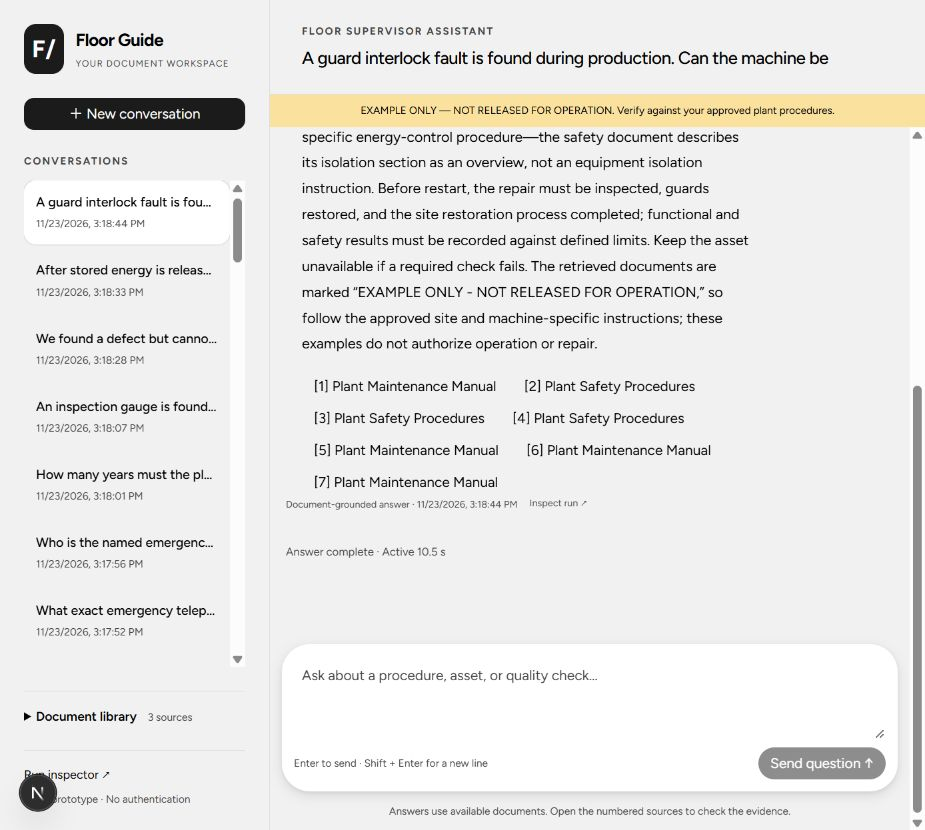

# Multi-source and acceptance-policy update

The acceptance policy requires 100% strict accuracy for safety-related scenarios
and at least 95% for non-safety scenarios. Safety applies across source topics,
including isolation, interlocks, emergency information, and operational
authorization. The evaluation-only case classification is in
`backend/evaluation_policy.json` and is never given to the agent.

The previous full 50-case baseline scores 24/30 safety and 14/20 non-safety under
this broader policy. Both gates fail. Incomplete evaluations cannot pass a gate.

## Implemented

- Search accepts an array of one or more SQLite-validated topic IDs. Scalar and
  duplicate IDs are rejected; no topic enum is hard-coded.
- Retrieval considers the best hit from each requested topic before filling
  remaining space with extra hits. Whole sections and the 6,000-unit per-search
  evidence budget are preserved. Missing topic coverage is explicit in tool
  results; a response cannot claim complete grounding while a requested topic
  has no retrieved evidence.
- The agent's prompt prioritizes required safeguards, roles, approvals, records,
  and hold/restart steps over brevity, and instructs follow-up searches for
  missing source coverage.
- Insufficient-evidence responses explicitly tell the user there is not enough
  information, identify missing values, and direct them to approved information.
  A small presentation follow-up avoids repeating that notice when the model
  already says it. Source/provider failures remain errors rather than absence.

## UI regression

18 live questions were submitted through the chat UI in fresh conversations:
the previous 12 strict failures and all six missing-information cases. The
question file alone was supplied to the agent. Raw browser results, saved
answers, citations, and action events are retained beside this report.

- All six missing-information cases still conveyed that the requested facts
  were unavailable, with no invented values.
- Case 038 now retrieved both maintenance and quality evidence and included
  identification/quarantine, Quality evaluation/calibration/containment, and
  retrospective product review. The array and balanced retrieval addressed the
  previously diagnosed retrieval failure.
- Cases 021, 035 and 041 now conveyed their previously omitted required facts.
- Case 044 delivered an answer this time, but still omitted some required
  release/traceability and packaging detail; it remains a strict failure.
- Cases 007, 023, 024, 031, 032 and 033 still omitted required facts.
- Case 022 failed exact-quote validation after its correction. Its search had
  retrieved both requested source types; this was a citation failure.

Semantic review therefore passes 10/18 targeted scenarios, including 4/12 of
the previous failures and 6/6 missing-information cases. This selected subset
is not a new overall accuracy score. **The application does not yet meet the
100% safety / 95% non-safety acceptance thresholds.** Prompt changes alone did
not resolve all answer-completeness and citation-generation failures. A full,
fresh, semantically graded suite is required before any acceptance claim.

The initial code checks passed 74 offline backend tests and Ruff validation;
two further tests cover the notice deduplication follow-up. No frontend source
or observability changes were made for this update. Mobile testing was excluded.

